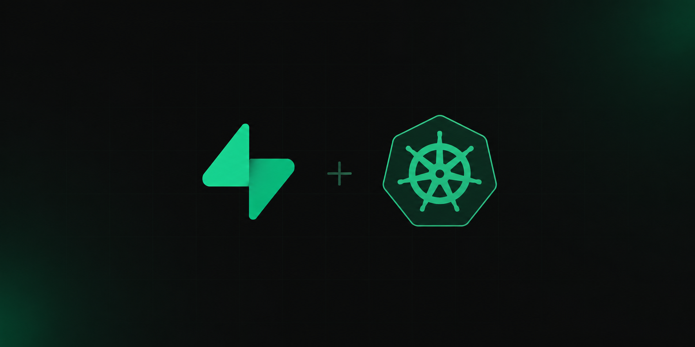

<p align="center">
  <a href="https://github.com/supabase-community/supabase-kubernetes">
    
  </a>
</p>

---

<p align="center">
  Run <a href="https://github.com/supabase/supabase">Supabase</a> on your own cluster with the Supabase Kubernetes Operator.
</p>

<p align="center">
  <a href="#overview">Overview</a> |
  <a href="#quick-start">Quick Start</a> |
  <a href="#versions-and-upstream">Versions and Upstream</a> |
  <a href="https://supabase.io/docs">Supabase Docs</a> |
  <a href="#contributing">Contributing</a>
</p>

The **Supabase Kubernetes Operator** manages Supabase through Kubernetes Custom Resources (`core.supabase.io/v1alpha1`). Use the `supabase-operator` chart to install the controller and CRDs, and the `supabase-project` chart to create a Supabase project.

The Operator is in an early stage of development and its API may change.

## Overview

The Operator exposes the following Kubernetes Custom Resources:

| Resource | Short name | Description |
|---|---|---|
| `Project` | `projects` | Shared configuration, credentials, migrations, and database synchronization |
| `SingleDatabase` | `singledatabases` | Postgres database managed by the Operator |
| `Migration` | `migrations` | Applies SQL scripts to referenced databases. Also used internally by the Operator to manage Supabase upgrade migrations |
| `Auth` | `auths` | Supabase Auth component |
| `Rest` | `rests` | PostgREST component |
| `Meta` | `metas` | Postgres Meta component |
| `Realtime` | `realtimes` | Supabase Realtime component |
| `Supavisor` | `supavisors` | PostgreSQL connection pooler (session and transaction modes) |
| `Storage` | `storages` | Supabase Storage component |
| `Analytics` | `analytics` | Logflare log management and analytics |
| `Vector` | `vectors` | Per-project Kubernetes log collection (DaemonSet) |
| `Studio` | `studios` | Supabase Studio component |
| `Envoy` | `envoys` | API gateway component |
| `EdgeRuntime` | `edgeruntimes` | Edge Functions runtime with operator-managed router and import map |

## Quick Start

Before you begin, make sure you have:

- A Kubernetes cluster (1.28+ recommended)
- `kubectl` configured to connect to your cluster
- `helm` 3.x+

Add the Supabase Helm repository:

```bash
helm repo add supabase https://supabase-community.github.io/supabase-kubernetes
helm repo update
```

### Deploy the Operator

Deploy the Operator into the `supabase-operator` namespace:

```bash
helm install supabase-operator supabase/supabase-operator \
  --version 0.8.3 \
  --namespace supabase-operator \
  --create-namespace
```

This installs the CRDs and deploys the controller in a single step.

### Deploy a Supabase Project

The `supabase-project` chart creates a `SingleDatabase`, a `Project`, and the enabled component resources. Install it with the default public URL (`http://localhost:8000`):

```bash
helm install supabase supabase/supabase-project \
  --version 0.8.3 \
  --set fullnameOverride=supabase
```

The Operator will provision the Postgres StatefulSet, the component Deployments, Services, Secrets, and run sync Jobs to configure JWT keys and the database.

Retrieve the generated database password, the Studio credentials, and the API keys with a single command:

```bash
kubectl get secrets supabase-postgres-auth supabase-envoy-auth supabase-jwt \
  -o go-template='{{range .items}}{{if eq .metadata.name "supabase-postgres-auth"}}{{printf "%-18s: %s" "Database Password" (.data.password | base64decode)}}{{"\n"}}{{end}}{{if eq .metadata.name "supabase-envoy-auth"}}{{printf "%-18s: %s" "Studio Username" (.data.username | base64decode)}}{{"\n"}}{{printf "%-18s: %s" "Studio Password" (.data.password | base64decode)}}{{"\n"}}{{end}}{{if eq .metadata.name "supabase-jwt"}}{{printf "%-18s: %s" "Publishable Key" (index .data "publishable-key" | base64decode)}}{{"\n"}}{{printf "%-18s: %s" "Secret Key" (index .data "secret-key" | base64decode)}}{{"\n"}}{{end}}{{end}}'
```

### Access Supabase

Once the resources are ready, forward the Envoy gateway to your local machine:

```bash
kubectl port-forward svc/supabase-envoy 8000:8000
```

The Studio and the Supabase APIs are available at [http://localhost:8000](http://localhost:8000).

### Access through Ingress

Set `ingress.enable: true` and `ingress.host` to expose Studio and APIs on the
same host. The Ingress forwards `/` to Envoy, preserving Studio authentication.
Set `project.publicUrl` to the corresponding public URL. Optional `className`,
`annotations` and `tls` fields configure the controller and TLS termination.
The cluster must provide the Ingress Controller and TLS Secrets. Envoy must be
enabled, and Service overrides must preserve its named port `envoy`.

## Versions and Upstream

The Operator and the `supabase-operator` and `supabase-project` charts share the version of the Supabase self-hosted release they target. Operator `v0.8.3` and both charts at `0.8.3` target upstream [`self-hosted/v0.8.3`](https://github.com/supabase/supabase/releases/tag/self-hosted/v0.8.3). Install matching versions of the two charts.

This version identifies the upstream baseline. The Operator aims to follow its behavior while adapting it to Kubernetes; it does not imply support for every optional Docker Compose configuration or a stable Kubernetes API.

Before upgrading, read the [upstream self-hosted changelog](https://github.com/supabase/supabase/blob/master/docker/CHANGELOG.md) for component changes and upgrade requirements, and the [Operator release notes](https://github.com/supabase-community/supabase-kubernetes/releases) for Kubernetes-specific changes. Release notes link to the changelog at the corresponding upstream tag.

## Contributing

Contributions are welcome. Before starting significant work, please open an issue to discuss your idea or bug report. When you are ready, fork the repository, make your changes, and open a pull request.

The Operator aims to follow the behavior of the [upstream self-hosted setup](https://github.com/supabase/supabase/tree/master/docker). For fixes or behavior changes that also apply there, consider opening a pull request upstream first, then link it in your contribution here. Kubernetes-specific changes belong in this repository; explain any intentional differences from upstream.

For setup instructions, build commands, and testing workflows, see [DEVELOPERS.md](./DEVELOPERS.md).

## Support

This project is supported by the community and not officially supported by Supabase. Report problems with the Operator, its charts, or Kubernetes integration in this repository. If a problem also reproduces in the upstream self-hosted setup, report it upstream with a reproduction and link the related issues.
